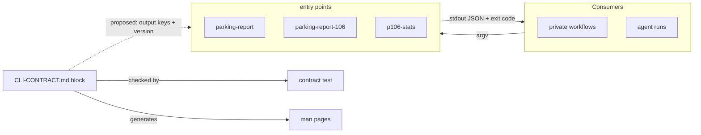

# Design note: a versioned, machine-readable CLI contract

- **Issue:** #73
- **Status:** Proposal, waiting for the owner's sign-off. Nothing here is
  implemented or adopted by this note.
- **Date:** 2026-11-05
- **Base measured:** `main` at `b4858848`

## Context: what #73 asked for, and what already landed

#73 treats the CLI as the supported operator API and asks for `--json` on
every command, documented exit codes per command, semver with a CHANGELOG
and a flag-stability policy, with the OpenAPI/HTTP work kept separate. Its
verification line is "`--json` everywhere, contract doc merged, version
policy in CONTRIBUTING/STYLE".

Part of that is already on `main`:

- [CLI-CONTRACT.md](CLI-CONTRACT.md) (v0, #126) pins the flags, defaults,
  exit codes and, for `parking-report-106`, the JSON keys of all four
  entry points in one machine-readable block (`contract_version: 0`).
  `tests/test_cli_contract.py` checks it against the real parsers and exit
  paths, and `scripts/gen_manpages.py` generates the man pages from the same
  block.
- The [flag-stability policy](CLI-CONTRACT.md#flag-stability-policy) was
  adopted by the maintainer (decision 6433915118), and
  [CHANGELOG.md](../CHANGELOG.md) records contract changes under
  "Unreleased (planned 0.5.0)".

This note covers what is still open: the `--json` gaps, a shared exit-code
table, how JSON output is versioned, and the release questions the policy
depends on.

## Measured current state

Read from `src/parking_report/{cli,api_cli,http_service,stats_cli}.py` and
`[project.scripts]` at the base above. "Pinned" means the contract block
in CLI-CONTRACT.md states it and the contract test enforces it.

| Entry point | Subcommands | `--json` today | What it emits on stdout | Exit codes in the code | Pinned in CLI-CONTRACT.md |
|---|---|---|---|---|---|
| `parking-report` | none (positional `input` or `--intake DIR`) | Only with `--municipality` (`--json` alone exits 2) | With `--municipality --json`: an indented JSON array, one object per car mapping form field to value. Otherwise plain report text, or numbered text blocks with `--municipality`. Intake notes go to stderr. | `0` success or `--help`; `1` `OSError`/`UnicodeError`/`ValueError`, `error: ...` on stderr; `2` argparse or flag-combination rule | Flags, defaults, codes 0/1/2, `json_output: "only with --municipality"`. The array's keys are **not** pinned. |
| `parking-report-106` | none (positional `folder`) | Always JSON, no flag | One compact JSON line for every outcome after parsing: `dry_run`, `submit` or `blocked`, no envelope and no version key | `0` dry run or submit; `2` argparse; `4` any `Exception` after parsing, fixed `blocked` line; `5` submit done but a duplicate case was found | Flags, codes 0/2/4/5 and `stdout_keys` for all three line kinds |
| `parking-report-http` | none; argv ignored except `-h`/`--help` | Not applicable (an HTTP server) | Help text only; responses are HTTP JSON ([openapi.json](openapi.json)) | `0` help; `1` invalid configuration (fixed message, via `SystemExit(str)`); otherwise serves until stopped | Codes 0/1, environment names, the fixed message |
| `p106-stats` | `build`, `refresh` | No | One human summary line (`p106-stats: N incidents ... -> DIR`). The data goes to files: `summary.json`, CSV tables, `report.html` | `0` written; `1` input, environment, fetch or write error, `p106-stats: ...` on stderr; `2` argparse or an invalid value | Flags per subcommand, environment names, codes 0/1/2. The `summary.json` keys are **not** pinned in the block. |

Not checked: exit codes on exceptions outside the caught sets (for example
a `TypeError` in `parking-report`, or `KeyboardInterrupt` anywhere), and
the `scripts/` tools, which are developer tools and not entry points.

What the measurement shows:

1. **`--json` gaps.** Plain `parking-report` output and both `p106-stats`
   subcommands have no machine-readable stdout. The HTTP service needs none.
2. **Exit codes already agree.** `0` success, `1` input/config error, `2`
   usage error mean the same in every command that uses them. `4` and `5`
   exist only in `parking-report-106`, which maps every post-parse failure
   to `4` on purpose (fail closed, no exception text). So a shared table is
   documentation, not a renumbering.
3. **Only one JSON output carries pinned keys** (`parking-report-106`). No
   JSON output carries a version, so consumers cannot tell shapes apart.
4. **No release exists.** There are no git tags. `pyproject.toml` says
   `0.5.0` while the CHANGELOG says "planned 0.5.0", and an empty second
   `## Unreleased` heading sits at the bottom of the CHANGELOG. The policy's
   "at least one released minor version" has nothing to count yet.
5. The policy lives in CLI-CONTRACT.md. CONTRIBUTING.md and STYLE.md don't
   link to it, which #73's verification line asks for.

## Options

### A. Fill the gaps in place

Add `--json` where it is missing, with flat shapes like the existing ones.
Pin every JSON output's keys in the contract block. Add a shared exit-code
table to CLI-CONTRACT.md.

- Pros: no existing output changes, so consumers need no migration. Small
  additive PRs, each covered by the current policy.
- Cons: still no version marker in the output, so a later key change can
  only be detected through the package version.
- Cost: about four small PRs, each with tests and a contract update.

### B. One versioned envelope for every command

Every `--json` output becomes
`{"schema_version": 1, "command": ..., "data": ..., "errors": [...]}`.

- Pros: one parser for all commands, explicit versioning, and errors as
  data instead of stderr text.
- Cons: it breaks the `parking-report-106` line and the `--municipality`
  array that consumers already parse, so it needs a deprecation window and
  a period with both shapes (for example a `--json-format=v1` switch).
  `errors` would need care so that no exception text leaks, which
  `parking-report-106` avoids on purpose today.
- Cost: high. It touches every command, every contract entry and every
  consumer, and needs at least one released minor version carrying both
  shapes.

### C. The contract file as the single source for everything

Extend the block so that the parsers, the docs prose and the output
validation are all generated from it.

- Pros: drift becomes impossible. Man pages and the contract test already
  work this way.
- Cons: generating argparse from data is a large refactor of working,
  safety-gated code, and adds churn for little gain over the contract test.
- Cost: high. The cheap part (man pages and checks) already exists.

### D. Do nothing more and close #73 as met

- Pros: no cost.
- Cons: the verification line ("`--json` everywhere") isn't met, and the
  JSON keys stay partly unpinned.

## Proposed decision (for owner sign-off)

**A, plus a minimal version marker.** This is a proposal, not adopted.

1. Keep the existing JSON outputs exactly as they are: the
   `parking-report-106` line and the `parking-report --municipality --json`
   array. No envelope.
2. New `--json` outputs (plain `parking-report`, `p106-stats`) are flat
   objects or arrays like the existing ones. Every JSON output's keys are
   pinned in the contract block and checked against real output.
3. Versioning stays with the contract: `contract_version` in the block,
   plus the package version for releases. No `schema_version` key in the
   output for now. Adding one later is an additive key under the policy.
4. Add the shared exit-code table to CLI-CONTRACT.md as documentation. No
   renumbering.
5. Option B stays available later as an opt-in shape, if a consumer
   actually needs it.

## Migration for workflow consumers

The private workflows and agents that call the CLI aren't visible from this
repo, so everything in this section is generic guidance or a **guess**.

- Under the proposal, no existing output, flag or exit code changes, so no
  consumer has to migrate.
- Guess: the workflows mostly branch on the `parking-report-106` exit code
  and its `status` key. Both stay as they are.
- Generic guidance for consumers: pin a version (tag or commit); parse JSON
  by key and ignore unknown keys; branch on the exit code, never on stderr
  or human stdout text; move from the `p106-stats` summary line to
  `--json` once it lands.
- If a breaking change is ever chosen (for example option B), the policy
  applies: announce the deprecation in the CHANGELOG, keep the old shape for
  at least one released minor version, and make the new shape opt-in during
  that window. The security/privacy exception and the safety gates stay as
  the policy states them.

## PR split (each small and test-first)

1. **Exit-code table and policy links.** Docs plus a contract-test
   assertion that the table matches the block's `exit_codes`; the new test
   fails first. Link the policy from CONTRIBUTING.md and STYLE.md.
2. **Pin existing JSON keys.** Add the keys of the `--municipality --json`
   array to the block, with a test against real output.
3. **`parking-report --json` for plain reports.** Lifts the "requires
   `--municipality`" usage error for `--json` only. Additive under the
   policy; the shape is an owner question below.
4. **`p106-stats build|refresh --json`.** Prints one JSON object on stdout
   in place of the text line, with pinned keys. Files are unchanged.
5. **Optional: `parking-report-106` `build_parser()`.** Known gap 3, with
   no behaviour change, guarded by the contract test and `gen_manpages.py
   --check`.

Each PR updates the contract block, the CHANGELOG and the man pages
(through the generator) as the policy requires.

## Version, CHANGELOG and stability proposals (not implemented)

- **Release 0.5.0 first.** Tag the current `0.5.0` so that "a released
  minor version" means something, then land PRs 3–4 under "Unreleased
  (planned 0.6.0)".
- **Remove the stray empty `## Unreleased` heading** at the bottom of the
  CHANGELOG, in PR 1.
- **Bump `contract_version` to 1** when the block's own format changes
  (new `stdout_keys` entries in PR 2). Flag changes alone don't bump it;
  they follow the package version.
- **1.0** once every command has machine-readable output and one minor
  release has shipped with no breaking contract change.

## Open questions for the owner

1. Do you adopt the proposed decision (A plus `contract_version`), or do
   you want B's envelope?
2. What counts as a release for the policy: a git tag, a GitHub release,
   or something else? Should 0.5.0 be tagged now?
3. Plain `parking-report --json`: an array of report strings, or objects
   like `{"index": 1, "text": "..."}`?
4. `p106-stats --json`: replace the text summary line on stdout when the
   flag is set (proposed), or print both?
5. Is `contract_version` bumped by block-format changes only (proposed),
   or by every contract change?
6. When should 1.0 happen, and should the policy text move to (or only be
   linked from) CONTRIBUTING.md and STYLE.md?

## Out of scope

- OpenAPI and the HTTP service: see [HTTP-SCOPE.md](HTTP-SCOPE.md) and
  [openapi.json](openapi.json). `parking-report-http` gets no `--json`.
- Any change to safety or approval gates, live submission, or the ledger.
- The `scripts/` developer tools.
