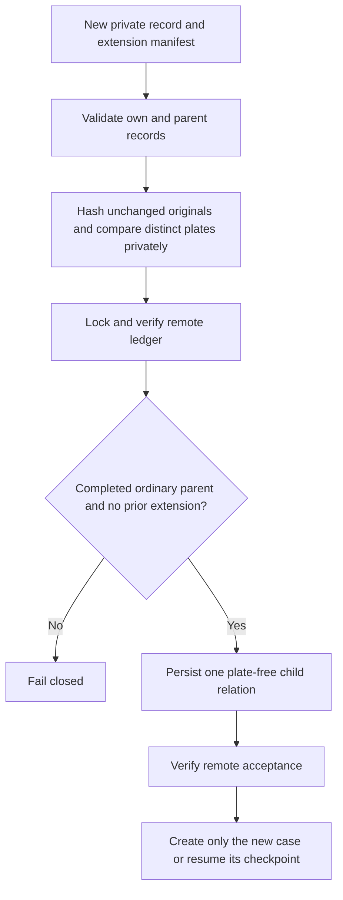

# Shared photo extension after a completed intake

- Issue: #293
- Status: proposal, pending owner sign-off
- Date: 2026-11-05
- Base measured: main `1c5c057` (before this proposal)

Not implemented. This document grants no live authority.

## Existing behavior

The shared-photo manifest in [SHARED-PHOTO.md](SHARED-PHOTO.md) already permits
exactly two distinct cars if both records are prepared before either reservation.
A record reserved without that manifest cannot acquire it retroactively because
its digest and relation are immutable. The existing behavior is correct and
must remain unchanged. The local operational runner may lag main; upgrading it
alone does not make an already-completed ordinary intake eligible for reuse.

## Goal and boundaries

Permit one explicitly approved, separately verified car in the unchanged
original of one completed ordinary vehicle intake. Do not change the original
photo bytes, parent payload digest, parent state, or original photo index.
Do not replace the ledger with an index containing plates or plate hashes.
No general migration, arbitrary group growth, non-vehicle reuse or live test
submissions are in scope. An approval reference records evidence; the caller
must recover and verify that evidence independently before any live use.

## Proposed private manifest

A new `shared_photo_extension` field on the new record carries exactly:

- `parent_id`: opaque existing intake folder name.
- `parent_digest`: existing payload digest.
- `parent_case_number`: independently grounded municipal reference.
- `photo_sha256`: unchanged original hash.
- `parent_plate` and `plate`: distinct strictly normalized standard plates.
- `authority_reference`: caller-verified approval evidence reference.

All fields and the new intake ID enter the new preview digest. The own plate
must match the new record; the parent plate must match the parent's structured
private record. Never parse plates from prose. Preserve leading zeros and reject
invalid or ambiguous normalization. Synthetic tests use shared synthetic-data
variables, not personal examples.

## Validation and reservation

1. Preview validates the new manifest and own record without reservation.
2. Live use requires the ordinary exact-digest gates plus an explicit
   extension-digest gate. Reject combination with `followup` or `shared_photo`.
3. Read the parent record from the same fixed sibling layout as #271, using the
   nonblocking regular-file reader from #284. Reject missing, unreadable,
   non-object or non-regular inputs without hanging. The new intake folder must
   sit beside the completed parent folder. A parent outside that layout is
   ineligible; support would require a future explicit path flag.
4. Check both actual originals have the declared hash and each record's plate
   matches the manifest. The 106-ledger parent entry is the source of truth for the submission digest;
   require the parent's private `report.json` to corroborate the same digest.
   Both must match `parent_digest`. Older parents without a verifiable digest
   in both sources are ineligible. Parent case association must carry verified
   provenance. An unverified FIFO association makes the parent ineligible; this
   feature cannot upgrade that association.
5. Under the existing ledger lock, verify remote head and parent identity. Parent
   must be complete, ordinary, own the original photo index, and match the exact
   stored digest/photo. An uncertain parent is not complete. Existing children,
   follow-ups or shared groups make the parent ineligible. Reconciliation is
   outside the scope of this feature.
6. Reserve one new intake and a plate-free relation containing the parent key,
   parent digest, photo hash and authority reference. A separate bounded index
   prevents a second extension of the same original. The parent key is the hashed
   intake ID, consistent with #271: it binds the relationship to the immutable
   ledger identity without copying intake names or plates into the relation.
   Parent entries and original
   photo index remain byte-for-byte unchanged.
7. Persist and verify remote acceptance before any municipal effect. Retry with
   the same intake and manifest resumes its checkpoint. A changed relation,
   renamed intake, different photo or second target fails closed.

The relation must not store either plate or a value derived from plates. As in
#271, each retry rechecks both private records. An uncertain new create blocks
that intake without automatic retry; it never causes a parent resubmission.

## Tests first

Before implementation, add failing regression tests for:

- One completed ordinary parent plus one different plate succeeds; same plate,
  normalized spelling of the same plate, wrong hash/digest/case and missing
  authority reference fail before any fake create.
- Parent and original photo index stay unchanged; new member digest includes
  the full manifest and its ID.
- Same child retries resume; changed relation, renamed child, second extension,
  existing shared group or follow-up cannot add another case.
- Missing/FIFO/device parent records fail promptly; mismatched private records
  and changing parent files on retry fail closed.
- Stale/concurrent writers and uncertain remote writes block effects. Simulated
  interruption never repeats a completed create or original parent filing.
- Unknown legacy plate cannot be inferred. Non-vehicle behavior and all #271
  and follow-up tests remain unchanged. No plates or plate-derived values
  enter ledger output or diagnostics.

Run unit and mocked functional suites, lint and type checks at the exact head.
Run the full suite in the Docker test target and inspect its real result. A
missing local container runtime is a verification gap, not a passing result.
CI and independent exact-head review remain merge gates. No live municipal
writes are allowed during tests.

## Adopted review decisions

- Exactly one extension per ordinary photo is the initial bound.
- An unverified FIFO municipal-reference mapping makes the parent ineligible.
  A request to report another car does not verify the parent's reference.
- Parent submission digest comes from its 106-ledger entry and must be
  corroborated by the private parent record. Both are required; fail closed
  when either is missing or conflicts. Older ineligible parents are not
  migrated or reconstructed from changed descriptions.

Until this design is reviewed and implemented, use a separate original photo
or leave the new report pending. Even after implementation, these eligibility
rules still apply; the feature does not promise coverage for every old intake.
