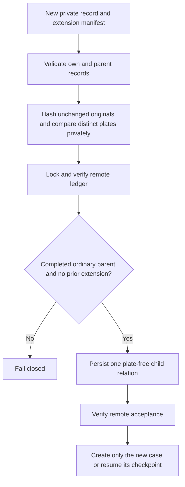

# Shared photo extension after a completed intake

- Issue: #293
- Status: approved by the owner; implemented (guard identity as selected by the owner)
- Date: 2026-11-05
- Base measured: main `efda4ca3ca87e3002fea0eddba46b844114a157b` (reviewed baseline #294)

Not implemented. This document grants no live authority.

## Existing behavior

The shared-photo manifest in [SHARED-PHOTO.md](SHARED-PHOTO.md) already permits
exactly two distinct cars if both records are prepared before either reservation.
A record reserved without that manifest cannot acquire it retroactively because
its digest and relation are immutable. The existing behavior is correct and
must remain unchanged. The local operational runner may lag main; upgrading it
alone does not make an already-completed ordinary intake eligible for reuse.

## Goal and boundaries

Permit one explicitly approved, separately verified car in the unchanged
original of one completed ordinary vehicle intake. Do not change the original
photo bytes, parent payload digest, parent state, or original photo index.
Add a domain-separated photo-plus-plate guard key only to the private ledger;
never store raw plates or derived keys in public repositories or logs.
No general migration, arbitrary group growth, non-vehicle reuse or live test
submissions are in scope. An approval reference records evidence; the caller
must recover and verify that evidence independently before any live use.

## Duplicate guard identity and privacy

The owner-selected guard identity is HMAC-SHA256 with a secret seed over a
domain-separated tuple of original photo SHA256 and strictly normalized plate.
Encode the tuple as canonical UTF-8 JSON with fixed fields, sorted keys and
compact separators: `domain`, `key_id`, `photo_sha256`, `plate`. The domain is
`parking-report/photo-vehicle/v1`. Preserve leading zeros and canonicalize
standard plate formatting. Synthetic test vectors pin encoding and output.

The seed belongs in a GitHub Actions Secret in the PRIVATE reports environment,
not a GitHub Variable, source, ledger, logs, diagnostics or artifacts. The caller
supplies it only at runtime. At provisioning generate a cryptographically random
seed of at least 128 bits (256 bits recommended), never a passphrase or reused
value. Workflows must never pass it into PR-triggered or fork-triggered contexts. This design neither creates nor sets the secret;
seed provisioning needs a separate owner-approved step. Public helper tests use
synthetic seeds only, never the production secret or real evidence.

Store only `(key_id, derived guard key) -> hashed intake ID` in an optional
private-ledger index. The index carries an immutable key version and a keyed verification value
using the distinct domain `parking-report/photo-vehicle-key-verifier/v1` and a
fixed public check string. Verify that
value in constant time before reservation. A missing, invalid, unknown-key-id or
mismatched seed fails closed before any ledger change or municipal effect. The
verification value is not the seed and must never be treated as one.

Same original plus same plate under the same key version is blocked for a new
intake ID; unchanged same-ID retries resume. A different verified plate is allowed
only within the one-extension bound and all parent-binding checks. Public output
and parent/child relations remain plate-free and contain no derived guard key.
This creates one intentional PRIVATE-index exception to #283's rule that the
ledger holds nothing derived from plates; update SHARED-PHOTO.md accordingly
when implementing, without relaxing that rule for any public output.
A key alone does not prove a plate is visible or permit cropping/re-encoding to
evade original-source duplicate protection.

## Seed lifecycle and ledger compatibility

No production entries for this feature exist yet. Existing v1 ordinary entries
remain untouched and continue their photo-only protection. Initialize the optional
index with one explicitly provisioned key ID and its verification value only in
a reviewed provisioning operation, never opportunistically on a live submission.
Legacy parent eligibility still requires the corroboration below; absence of a
new guard entry is not permission to reuse arbitrary old photos.

Do not silently re-key when a seed changes. A different key ID is refused by this
first version. Rotation requires a separate reviewed migration: retain the old
key until all affected pairs can be recomputed from verified original private
records, populate the new index while preserving old duplicate coverage, verify
counts/conflicts and atomic remote acceptance, then explicitly switch the active
key ID. If original evidence or the old key is unavailable, stop. Implementing
rotation or automatic migration is outside this feature; version metadata makes
the future work possible without an unsafe fallback.

HMAC prevents plate enumeration by a ledger reader who lacks the seed. A reader
with both seed and original photo hash can still guess plates, so keep both seed
and private data restricted. Secret masking is not a substitute for avoiding
output. No test, fixture, exception, subprocess argument or artifact may expose
the production seed. Live seed setup and municipal tests are not part of this PR.

## Proposed private manifest

A new `shared_photo_extension` field on the new record carries exactly:

- `parent_id`: opaque existing intake folder name.
- `parent_digest`: existing payload digest.
- No municipal case number in the manifest: municipal numbering is metadata,
  not duplicate identity.
- `photo_sha256`: unchanged original hash.
- `parent_plate` and `plate`: distinct strictly normalized standard plates.
- `authority_reference`: caller-verified approval evidence reference.

All fields and the new intake ID enter the new preview digest. The own plate
must match the new record; the parent plate must match the parent's structured
private record. Never parse plates from prose. Preserve leading zeros and reject
invalid or ambiguous normalization. Synthetic tests use shared synthetic-data
variables, not personal examples.

## Validation and reservation

1. Preview validates the new manifest and own record without reservation.
2. Live use requires the ordinary exact-digest gates plus an explicit
   extension-digest gate. Reject combination with `followup` or `shared_photo`.
3. Read the parent record from the same fixed sibling layout as #271, using the
   nonblocking regular-file reader from #284. Reject missing, unreadable,
   non-object or non-regular inputs without hanging. The new intake folder must
   sit beside the completed parent folder. A parent outside that layout is
   ineligible; support would require a future explicit path flag.
4. Require the new record's photo bytes to be identical to the parent's original
   photo. Check both originals have the declared hash and each record's plate
   matches the manifest. The 106-ledger parent entry is the source of truth for the submission digest;
   require the preserved private submission artifacts to corroborate that digest.
   Accept a recorded `report.json` submission digest or the original unchanged
   `municipal-payload.json` digest plus its saved submitted payload, matching the
   report description and subject/address fields. Both the ledger and preserved
   artifacts must match `parent_digest`. Recompute the payload digest through
   the existing preparation contract with the original photo and original
   reporter inputs; never print or persist those reporter secrets. A saved
   digest string alone is not sufficient corroboration. The corroborated and
   recomputed payload's plate must equal the parent record's structured plate
   and the manifest's `parent_plate`; fail closed on divergence. Missing original
   inputs, changed payload or conflicting records make the parent ineligible.
   A municipal reference is optional metadata and does not select the parent.
   Preserve its provenance verbatim, including an unverified FIFO association.
   This feature must never upgrade it to owner-attested or city-verified.
5. Under the existing ledger lock, verify remote head and parent identity. Parent
   must be complete, ordinary, own the original photo index, and match the exact
   stored digest/photo. An uncertain parent is not complete. Existing children,
   follow-ups or shared groups make the parent ineligible. Reconciliation is
   outside the scope of this feature.
6. Reserve one new intake, its private photo-plus-plate guard key, and a plate-free
   relation containing the parent key,
   parent digest, photo hash and authority reference. A separate bounded index
   prevents a second extension of the same original. This index is additive and
   optional, keeping ledger version 1 as `shared_photos` did. The parent key is the hashed
   intake ID, consistent with #271: it binds the relationship to the immutable
   ledger identity without copying intake names or plates into the relation.
   The authorized child reservation is exempt from the original-photo index's
   single-intake refusal for this exact photo only; that index keeps pointing
   to the completed parent. Parent entries and original photo index remain
   byte-for-byte unchanged.
7. Persist and verify remote acceptance before any municipal effect. Retry with
   the same intake and manifest resumes its checkpoint. A changed relation,
   renamed intake, different photo or second target fails closed.

The relation must not store either plate or the derived guard key; only the
private duplicate index stores that key. As in
#271, each retry rechecks both private records. An uncertain new create blocks
that intake without automatic retry; it never causes a parent resubmission.

## Tests first

Before implementation, add failing regression tests for:

- One completed ordinary parent plus one different plate succeeds; same plate,
  normalized spelling of the same plate, wrong hash/digest and missing
  authority reference fail before any fake create.
- Parent record plate diverging from the corroborated payload fails closed.
- Parent and original photo index stay unchanged; new member digest includes
  the full manifest and its ID.
- Missing seed, wrong seed, unknown key ID and malformed verification metadata
  fail before reservation or fake create; no silent initialization or re-keying.
- No real seed appears in captured logs, diagnostics, exceptions or artifacts;
  synthetic seeds alone appear in public tests. Existing legacy entries stay
  unchanged and cannot bypass corroboration by lacking a new guard entry.
- Same child retries resume; changed relation, renamed child, second extension,
  existing shared group or follow-up cannot add another case.
- Missing/FIFO/device parent records fail promptly; mismatched private records
  and changing parent files on retry fail closed.
- Stale/concurrent writers and uncertain remote writes block effects. Simulated
  interruption never repeats a completed create or original parent filing.
- Unknown legacy plate cannot be inferred. Non-vehicle behavior and all #271
  and follow-up tests remain unchanged. No raw plates enter the ledger; derived
  keys appear only in its private duplicate index, never public output or
  diagnostics.

Run unit and mocked functional suites, lint and type checks at the exact head.
Run the full suite in the Docker test target and inspect its real result. A
missing local container runtime is a verification gap, not a passing result.
CI and independent exact-head review remain merge gates. No live municipal
writes are allowed during tests.

## Revised review decisions (pending fresh independent review)

- Exactly one extension per ordinary photo is the initial bound.
- The guard key is a versioned domain-separated HMAC of original photo hash
  plus normalized plate, stored only in the private ledger as specified above.
- Duplicate identity binds the internal parent intake ID, ledger digest and
  original photo, not the municipal case number. A FIFO reference may remain
  explicitly unverified metadata. It is never upgraded by reuse approval.
- Require explicit owner approval to use that exact unchanged original for the
  separately identified new car while leaving the parent untouched. The owner
  is approving the new action, not certifying an unknown municipal mapping.
- Parent digest comes from the 106-ledger entry, corroborated against preserved
  original private submission artifacts and recomputed original inputs. No
  retrospective field added to a parent can stand in for that evidence.
- Missing/conflicting original evidence still fails closed. This is not a
  migration and creates no general exception for every old intake.

Until this design is reviewed and implemented, use a separate original photo
or leave the new report pending. Even after implementation, these eligibility
rules still apply; the feature does not promise coverage for every old intake.
